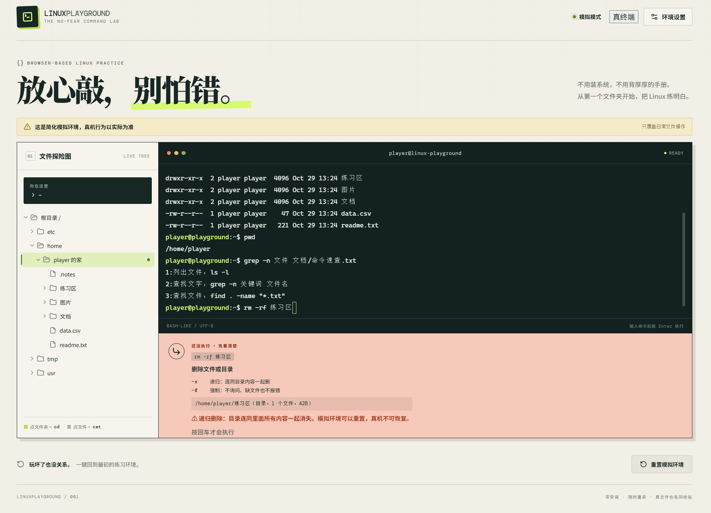
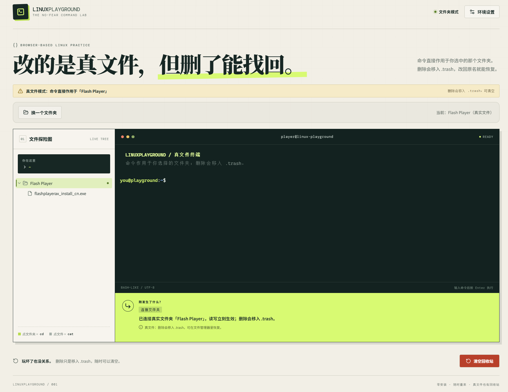
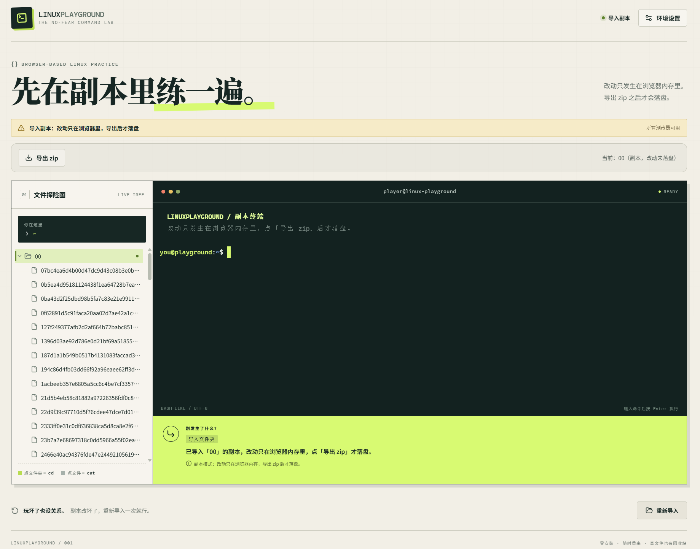
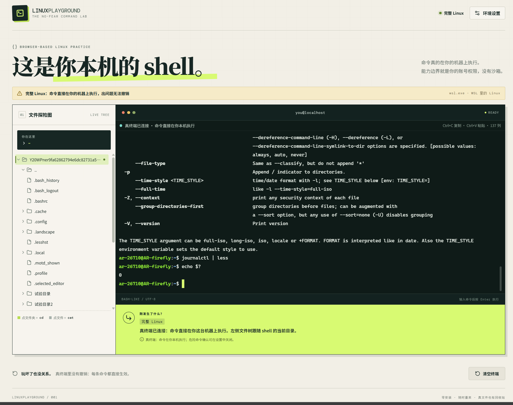

# LinuxPlayground

**放心敲，别怕错。** 浏览器里的 Linux：能纯练习，能直接改你真文件夹，也能连上你本机的真终端。



- **在线体验**：https://linux-playground.app.workbuddy.host/?sharecode=Y77AU6UAC4
- 一个网页，四层能力：

| 模式                 | 给谁                       | 操作对象                       | 安装         | 浏览器                       |
| -------------------- | -------------------------- | ------------------------------ | ------------ | ---------------------------- |
| **模拟练习**（默认） | 新手、没装 Linux 的人      | 浏览器里的虚拟文件             | 零           | 全部                         |
| **连接文件夹**       | 只想用基础命令整理电脑的人 | **你亲手授权的一个真实文件夹** | 零           | Chrome / Edge 86+、Opera 72+ |
| **导入文件夹**       | 其他浏览器用户             | 导入的副本，导出 zip           | 零           | 全部                         |
| **完整 Linux**       | 专业用户                   | **你本机的真 Linux（全权限）** | 本机启动网关 | 任意                         |

> 页面显著位置标注当前模式在操作什么，防止把模拟当真实。

## 设计理念

**先让人敢敲，再让人敲对。**

装 Linux 这件事本身就够劝退：分区、双系统、虚拟机，每一步都可能让人卡在开始之前。所以这里从零安装的地方起步——先有一个怎么敲都不会坏的环境。

**每一条命令都当场解释。** 敲完 `ls`，旁边立刻告诉你"列出当前文件夹里有什么"。不要求先背手册，也不假设你记得上一章。

**拆掉"不知道自己站在哪"的挫败。** 新手最常见的卡点不是命令写错，是位置找错：命令全对，文件就在隔壁目录。所以文件树和终端是联动的——点一下文件夹，终端里自动跑一遍 `cd` 并回显，你能看见"刚才发生了什么"。

**安全交给模拟层，能力交给完整 Linux 层。** 练习不需要代价，真刀真枪需要明确的许可。两种需求不混在一起：模拟模式不碰磁盘，完整 Linux 模式切换前必须弹窗确认，危险命令二次确认。

**不藏东西。** 不落盘、不上传、没有云端服务器参与——你在这里敲的每一条命令，都只发生在你自己的浏览器里。

## 四种模式

### 1. 模拟练习（默认，不碰你的电脑）

终端 + 文件树，命令由前端虚拟文件系统执行：`rm` 删的是内存里的假文件，随便玩，一键重置。适合先熟悉手感。

### 2. 连接文件夹（零安装，直接改真文件）

设置 → 连接文件夹 → 系统弹窗里选一个文件夹 → 之后的 `ls`/`cat`/`mkdir`/`echo >`/`rm` 全部作用在**真实磁盘**上。

- **只碰你选的那一个文件夹**：范围由浏览器强制限制。
- **删除是软删除**：移进该文件夹里的 `.trash`，随时可清空，也能手动恢复。
- 连接前有弹窗说明；权限随时能在浏览器地址栏撤销；刷新页面若仍授权会自动恢复。



**浏览器限制**：`showDirectoryPicker` 只有 Chromium 系支持（Chrome/Edge 86+、Opera 72+）。Firefox、Safari（含所有 iPhone/iPad 浏览器）、QQ 浏览器 14.9 均不支持——入口会置灰并说明。不支持的浏览器请用「导入文件夹」。

### 3. 导入文件夹（全浏览器兜底）

选一个目录（或直接拖进页面），文件被读进内存副本，命令照常跑；做完点「导出 zip」，解压替换回原文件夹。

- **改的是副本**，原文件不动；不点导出就什么都不会落盘。
- 自动跳过 `.git`、`node_modules`、`.DS_Store`；上限 1500 个文件 / 64MB（按字节）。



### 4. 完整 Linux（真终端，Linux 能做的都能做）

本机网关 + PTY 真终端，浏览器里就是货真价实的 bash：`vim`、`top`、`ssh`、`apt` 全都能跑。



```bash
git clone <本仓库地址>
cd LinuxPlayground && npm install
npm run real
```

启动后打开它打印的地址（默认 `http://127.0.0.1:8765`）→ 环境设置 → 完整 Linux → 我已知晓，然后直接敲命令。

- 要求：**Linux / macOS / Windows+WSL**、Node.js ≥ 18，无需 sudo。Windows 需一次性装 WSL（见下表）。
- Windows 用户：管理员终端执行 `wsl --install -d Ubuntu`，重启后**直接在 Windows 里** `npm run real`（Ubuntu 里不用装 Node）。
- 切换时弹窗确认（真机、全权限、不可撤销）；危险命令二次确认默认开启，可在弹窗里关掉。
- PTY 三档：Linux 用原生 `script`（装了 `node-pty` 可窗口自适应）、macOS 用系统自带 `script`、Windows 经 `wsl.exe` 用 WSL 里的 `script`。

**谁需要额外装什么**

| 你的系统               | 还要装什么                       | PTY 从哪来                                                                    |
| ---------------------- | -------------------------------- | ----------------------------------------------------------------------------- |
| Linux                  | 不用（Node ≥ 18 跑仓库本来就要） | 原生 `script`；装了 `node-pty` 还能窗口自适应                                 |
| macOS                  | 不用                             | 系统自带 `script`（零安装；全屏程序尺寸固定）                                 |
| Windows + WSL          | 一次性装 WSL（需重启一次）       | 网关经 `wsl.exe` 进 Ubuntu，用 Ubuntu 自带 `script`——**Ubuntu 里不用装 Node** |
| 只有 Windows，没装 WSL | 装 WSL，或就用前三种零安装模式   | —                                                                             |

- 线上 https 页面无法直连 `ws://127.0.0.1`，所以这一层只在网关托管的本地页面里可用。详见 `docs/完整Linux模式.md`。

## 支持的命令

模拟练习与连接文件夹共用同一套语义：`pwd` / `ls -l -a -R` / `cd`（含 `~`、`..`）/ `cat` / `mkdir -p` / `touch` / `cp`（目录需 `-r`）/ `mv` / `rm -r -f` / `less`（分页、`/` 搜索、`q` 退出）/ `chmod`_ / `echo`（含 `>`、`>>`）/ `grep -n -c` / `find 路径 -name "通配符"` / `which`_ / `whereis`\* / 管道 `|` / 重定向 `>`、`>>`、`2>`。

\* `chmod`、`which`、`whereis` 只有在完整 Linux 模式里才真实存在；连接文件夹模式会明确提示。

完整 Linux 模式没有命令白名单——那就是你的 shell。

## 安全边界

- **模拟 / 导入**：不触碰真实磁盘。
- **连接文件夹**：浏览器只授予选中目录的读写权；删除走 `.trash` 软删除。
- **完整 Linux**：网关只监听 `127.0.0.1`，随机令牌校验；能力边界就是你的账号权限，切换前必须确认。
- 不落盘、不上传：模拟与文件夹模式全部在浏览器里执行，没有云端服务器参与。

## FAQ

**Q：连接文件夹和导入文件夹差在哪？**
连接 = 直接改磁盘上的真文件，删了进 `.trash`；导入 = 读一份副本到浏览器里改，必须点「导出 zip」才落盘。前者只有 Chrome/Edge 能用，后者所有浏览器都能用。

**Q：连接文件夹会动我其他文件吗？**
不会。浏览器只给了你选中目录的句柄，其他路径在代码里根本不存在。

**Q：为什么火狐/QQ/苹果自带浏览器不能用连接文件夹？**
它们不实现 File System Access API。这是浏览器厂商的边界，不是我们的取舍。用「导入文件夹」即可。

**Q：删错了怎么办？**
连接文件夹模式下文件在 `.trash` 里，名字是 `<ISO时间戳>-<原名>`，改回原名拖回去即可；导入模式下重新导入原始文件夹。

**Q：完整 Linux 安全吗？**
它是真的 shell，没有沙箱、没有白名单；安全边界就是你的账号权限。切换前有弹窗，危险命令默认二次确认。它只监听本机，令牌每次启动随机生成。

## 开发

```bash
npm --prefix web install      # 前端依赖
npm install                    # 网关依赖（ws）
npm run dev                    # 本地开发预览
npm run build                  # 构建到 web/dist
npm run real                   # 启动完整 Linux 网关（仅 Linux）
npm test                       # 单元测试（105 项）
cd web && npm run test:e2e     # 浏览器端到端（10 项）
npm run test:agent             # 网关测试（16 项：平台纯函数 + HTTP/WS）
```

## 文件结构

```
linux-playground/
├── web/                      # 网页源码
│   ├── src/
│   │   ├── engine/           # 模拟层：虚拟文件系统、命令引擎、行编辑、Tab 补全、危险命令预演
│   │   ├── fs/               # 连接文件夹：File System Access API 与真实目录读写
│   │   ├── pty/              # 完整 Linux：真终端客户端与危险命令判定
│   │   ├── components/       # 终端、文件树、解释卡、设置、确认弹窗
│   │   └── styles/
│   ├── tests/                # 单元测试（vitest）
│   ├── e2e/                  # 浏览器端到端（Playwright）
│   └── scripts/              # 截图脚本
├── agent/                    # 完整 Linux 网关（PTY + WebSocket）
├── docs/                     # 模式说明
│   └── screenshots/          # 界面截图
├── 需求文档.md                # v1.10 规格
├── package.json              # 网关依赖与顶层脚本
└── README.md
```

## 适用人群

- **刚接触 Linux，还没装系统的人** —— 用模拟练习把常用命令敲熟，敲坏了点一下重置。
- **只想用基础命令整理电脑的人** —— 连接文件夹，直接在你授权的那个文件夹里 `ls`、`cp`、`mv`、`rm`。
- **用火狐、Safari、QQ 浏览器的用户** —— 浏览器不支持连接文件夹，用导入副本加导出 zip。
- **需要完整 shell 的人** —— 本机启动网关，浏览器里就是货真价实的 bash。

## 许可

[AGPL-3.0](LICENSE)

## 作者

AR-26710
